 

## Sobre mim

Crio projetos no Discord desde 2022, entre servidores, bots e eventos, e de vez em quando viro desenvolvedor de aplicativos. Gosto de pegar uma ideia e colocá-la em prática.

| | |
|---|---|
| **Comunidades** | Criação e gerenciamento de servidores de qualquer porte, com foco em funcionalidade e experiência de quem participa |
| **Administração** | Moderação de comunidades e equipes |
| **Design** | Identidades visuais e olhar estético apurado |
| **Marketing** | Noções de marketing digital para crescimento e engajamento |

## Projetos

  

  

 

## Ferramentas

## Contribuições

- **Global**, desenvolvedor: conecta comunidades brasileiras sem sair do próprio servidor
- **Ouce**, criador: ouça a sua música, do seu jeito
- **#XCriaUmSite**, criador: [meu primeiro site](https://github.com/xMqRs/xMqRs.github.io)
- **Comunidade Pudinesca**, moderador

## Números

  

